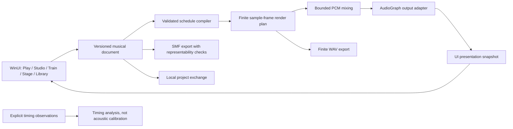

# Architecture and engineering gates

## Boundaries

The application is local-first. The WinUI shell, operating-system adapters and
workspace storage reference a platform-independent Core library, never the other
way around. The exact shared APIs are in IMPLEMENTATION-CONTRACT.md.

The UI refresh clock must never schedule audible clicks. All onsets are compiled
to frame positions. A render position is not a proven audible-at-speaker position;
queued audio and device latency remain distinct. Pausing and muting cannot
retroactively retract already buffered samples.

## Musical invariants

- Displayed BPM carries an explicit note unit. Musical position is measured in
  quarter notes; compound meter does not silently redefine BPM.
- Main click, subdivision, authored lane and performer timing target are
  different concepts. A silent training gap does not erase the intended rhythm.
- Constant, time-linear and beat-linear tempo evolution are different functions.
  Segment endpoints belong to exactly one segment.
- Polyrhythm shares a cycle; polymeter shares an underlying pulse. Do not reduce
  one to the other merely because a visualization looks similar.
- Document validation rejects unsupported cost, numeric and schema states
  explicitly. Resource bounds are safety constraints, not permission to drop
  generated notes.
- WAV export uses the same rendering model; MIDI has its own representability
  limits. Neither a successful file write nor a MIDI approximation proves exact
  equivalence without format-level assertions.

## Reliability, privacy and safety

Playback is stopped at startup. Navigation must preserve one transport. User
editing survives Stop. Device failure is visible and cannot silently redirect
headphone output to speakers. Input/recording is opt-in, not a prerequisite for
output-only practice.

Documents and exports are untrusted input. Validate version, ranges, collection
sizes and recursive setlists before scheduling. Write user files atomically and
preserve the previous target on cancellation/failure. Every write that a person
asks for has a cancellation token that closing the window cancels; the window
waits for the writes to stop (4 seconds at most), so that no temporary file is
left beside a destination, and names in the log a write that has not stopped by
then. Do not deserialize runtime types from user-controlled metadata.

The product avoids an account/cloud dependency for musical functionality.
External sync, device integrations, proprietary DSP and licensed sound libraries
remain separate capability, license and privacy gates.

## Evidence by development phase

| Phase | Gate |
|---|---|
| Discovery | Primary-source competitive research and explicit assumptions |
| Design | Full capability specification, original artboards and two distinct model critiques |
| Architecture | Contracted platform boundary and formal musical/timing semantics |
| Implementation | Functional controls and explicit unsupported states; no fake output |
| Verification | Deterministic regression tests, actual Windows builds and native activation |
| Review | Dependency review, CodeQL and an actual requested/completed Copilot review record |
| Delivery | Tested-SHA ZIPs, checksums, reproducible MSIX packaging and protected Store submission |
| Acceptance | Physical-device audio/install/accessibility results and reconciled feature coverage |
| Operation | Visible failures, local recovery, weekly dependency updates and verified release status |

These gates do not substitute for one another. The full design remains the
target; an engineering preview is labelled as such until acceptance is complete.
