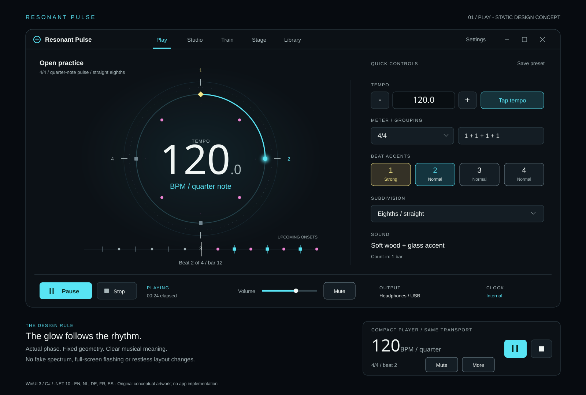
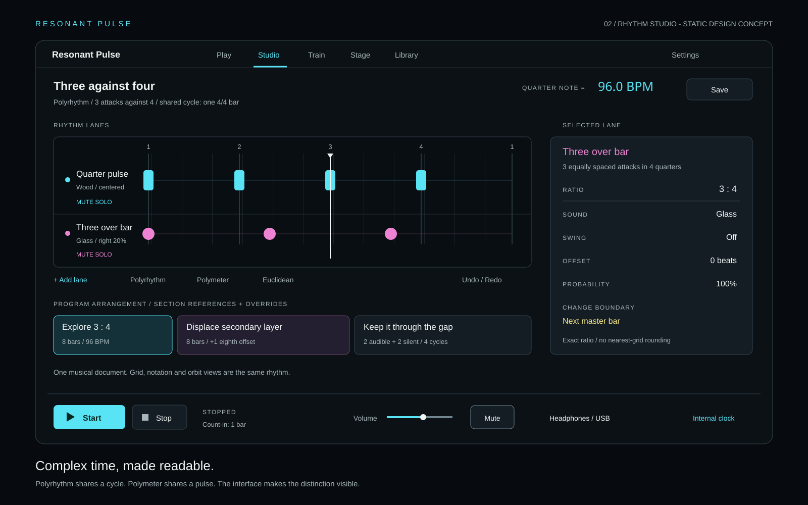
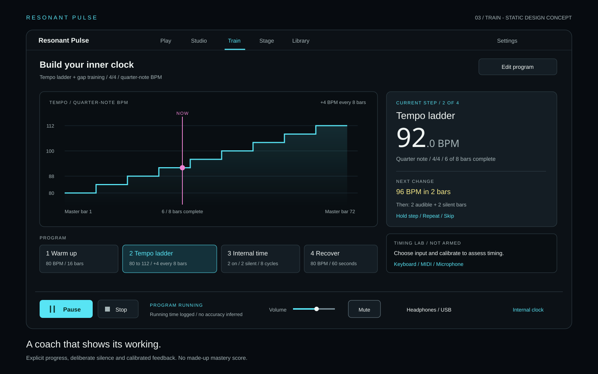
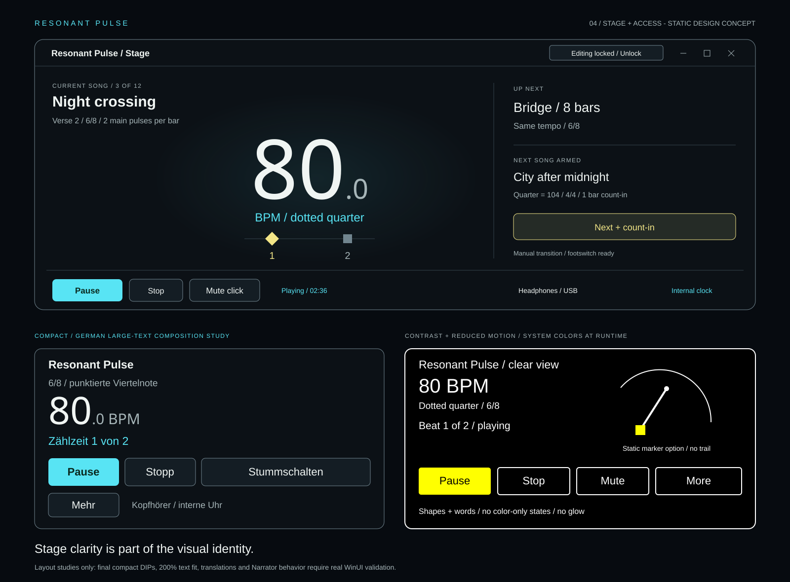

# Resonant Pulse
## Metronome and rhythm workstation - product and experience design

**Status:** revised design proposal after independent GPT-6.1 Sol and Claude Sonnet 5.5 critiques; not an implemented app. Research snapshot: 25 October 2026.
**Working name:** Resonant Pulse. Neither name availability nor trademark clearance has been established.
**Confirmed:** native WinUI 3 and C#/.NET 10; Resonant family appearance; English, Dutch, German, French and Spanish; unusually comprehensive metronome; research and two-model critique before implementation. This document records the design-stage baseline. The owner subsequently authorized implementation, a public repository and release engineering; delivery evidence is tracked separately in ../DELIVERY.md.
**Working assumptions:** standalone companion app, Windows 11, offline-first core, local persistence, no account or subscription dependency. These are proposed product decisions, not requirements inherited from the tuner. In particular, the tuner's session-only storage would be inappropriate for saved exercises and setlists.

## 1. The product thesis

**An instrument for understanding, practising and performing rhythm.**

Open it and play a beat in seconds. Grow into compound meters, independent rhythm layers, deliberate-practice programs and stage-ready click tracks without replacing the app. The same rhythmic document powers every view; switching views never changes what is playing.

The differentiator is not claiming an unprecedented feature. Strong competitors already combine many of these capabilities. The proposed advantage is a cohesive native Windows experience: exceptional musical legibility, transparent training feedback, deterministic rhythm generation, sophisticated authoring, multilingual accessibility and visual polish. "Best on the market" is a goal to test with musicians, not a claim this research proves.

### Experience principles

- **Simple by default, deep on demand.** Tempo, meter, subdivision, accents, Tap and Play are immediately visible. Advanced capability is organized, not discarded.
- **One transport, one rhythm document, one timing authority.** No independent UI clocks.
- **The visual is the music.** Rings and traces represent actual scheduled beats, accents, phase and silence. No fake audio spectrum in a sound-generating metronome.
- **Stable, not frantic.** Fixed geometry and numeric baselines; no large layout changes at each beat or transport state.
- **Nothing important requires an explanation to undo.** Click an accent again to change it; expose its named states. Lock/unlock and mute/unmute are symmetric.
- **Stage safety beats animation.** Stop, mute and output state remain available at every size.
- **No fictional mastery score.** Distinguish logged practice, self-assessment and measured onset alignment.

## 2. What the competitive research actually established

Primary pages were fetched directly, rather than accepting search summaries as evidence. Vendor statements are feature evidence, not independent verification of timing or quality. Lack of documentation is not evidence of absence. Platform/edition differences remain important.

| Reference | Verified capability families | Design consequence |
|---|---|---|
| PolyNome [S1] | Two independent sequencers; meter/subdivision editing; voice counting; automated/random tempo changes; variable swing; displacement; rudiments; gap training; setlists; practice logs; MIDI control; audio/MIDI export; VoiceOver; media/chart workflows. Features vary by edition. | A basic metronome with presets would not be competitive. Integrate practice, performance and authoring. |
| Metronomics current manual [S2] | Custom subdivision ratios, independent sequence lengths, mixed meter segments, probability, swing/offset, audible/silent bars, tempo steps, count-off, playlists. Apple Pro additionally documents Grid/Wheel, calibrated audio/MIDI Inspector, sound import and audio/MIDI export. | Separate polyrhythm from polymeter; support gaps and randomness reproducibly; disclose platform and measurement limits. |
| Pro Metronome [S3] | Polyrhythm, gap/rhythm trainer, dynamic meters, accent levels, voice sounds, playlist sharing, auto-stop stage mode and programmed warmup/tempo changes. | These are expected capability families, not premium-sounding novelty claims. Its advertised microsecond precision is not adopted as an independently established benchmark. |
| TonalEnergy [S4, S5] | Click tracks with meter/tempo changes and accelerando/ritardando, random beat/bar silence, count-ins, drones, recording, presets, MIDI controls and Link. The site explicitly advertises a Windows/Mac desktop edition. | Competes with real desktop workstations, not only phone utilities. Do not assume all mobile features exist on each desktop build. |
| Soundbrenner [S6] | Current official page presents metronome plus practice tracking and learning. Its page extract did not establish all detailed sync/trainer features. | Keep practice continuity visible; do not manufacture detailed competitor gaps. |
| GapClick [S7] | Official material emphasizes internal-time practice using gaps and offset clicks. The accessible page was testimonial-heavy. | Include deliberate silence and displaced clicks, but do not infer a complete feature matrix from testimonials. |

Search also surfaced Tempo/Tempo Advance, Modacity and Dr. Betotte. Some supplied URLs were unavailable or insufficient to establish current feature/platform claims, so this proposal does not rely on them. The research is a broad capability survey, not a claim that every existing metronome was exhaustively audited.

## 3. Full product capability map

All rows below belong to the intended full product, not an arbitrary "MVP plus backlog." External integrations and measurement-dependent features have explicit feasibility/release gates in section 12. A staged implementation later should preserve this complete target.

| Domain | Planned capabilities |
|---|---|
| Everyday metronome | Numeric BPM entry; +/- and press/hold; mouse wheel when focused; tap tempo with selected note unit; tap-in-to-start with a chosen number of taps; half/double tempo with explicit beat-unit handling; Italian tempo terms as approximate labels; free-running/no-bar mode; count-in; pause/resume; stop/reset; beat/bar counters; elapsed/remaining timer; automatic stop by bars, beats or duration; first-run guided exercise and musical glossary. |
| Musical time | Explicit BPM note unit, including dotted values; simple/compound/odd meters; editable additive grouping such as 7/8 = 2+2+3; mixed-meter sequences; pickup bars; accents at bar/group/beat/subdivision levels; optional bar accent every N bars; ties/rests; pattern displacement; metric modulation with a displayed old-unit = new-unit relation. |
| Subdivisions and groove | Eighths/sixteenths; triplets/quintuplets/septuplets and custom N-in-M tuplets; rests and ties inside tuplets; per-beat variations; swing/shuffle with displayed ratio; explicitly authored tempo-dependent swing curves; straight exceptions; per-lane offsets; deliberate microtiming; flam/drag/roll helpers; original rhythm/rudiment examples; 2-and-4 jazz clicks, clave, aksak/Balkan groupings and cyclic/tala examples with culturally accurate labels and sam/khali markers reviewed by knowledgeable musicians. |
| Rhythm Studio | Multi-lane step and duration editing; per-step accent/velocity/probability; copy/paste/duplicate; undo/redo; multi-select; keyboard editing; rotation; inversion; Euclidean rhythm generator; lane lengths/phase; mute/solo; sound/pan/volume; notation/count-syllable and grid views of the same pattern; audible previews only on explicit request. |
| Layered time | True N:M polyrhythm over a shared cycle; three-way ratios; true polymeter with independent bar lengths on a shared underlying pulse; supercycle preview; ratio audition; lane alignment markers; optional click on common coincidences; common clock with no floating-point phase drift. |
| Time independence | Fixed audible/silent bars; audible/silent beats; random omissions; increasing silent intervals; gradual click-density reduction; offbeat-only click; displaced click; click every N beats/bars; keep/remove downbeat anchor; independent visual-cue masking during gaps; repeatable random seed for comparable exercises. |
| Tempo development | Step ladders by bars/time/repeats; continuous accelerando/ritardando; linear-in-time and linear-in-beat ramps explicitly distinguished; percentage or BPM steps; tempo bounds; up/down pyramids; alternating challenge/recovery; random tempos in limits; hold/finish/reverse at bounds; per-segment count-in; manual mastery confirmation. |
| Practice programs | Named sections with meter, groove, tempo, duration, loops and rest; nested repeat blocks with bounded execution preview; section cues; skip/repeat/hold current section; warmup/rehearsal/cooldown templates; a readable total-duration estimate; local goals, journals, exercise tags and history; no punishment for missed days. |
| Timing Lab | Keyboard/pad tap alignment; MIDI-note onset analysis; opt-in microphone/transient onset analysis; calibration profiles; signed early/late offset; median bias; robust spread; drift; matched/missed/extra attacks; confidence/coverage; gap-return alignment; session comparison at like-for-like settings; optional recorded takes and waveform review. |
| Stage and rehearsal | Large high-contrast tempo/beat/section; arm-then-start setlist item; one-action Next + count-in; explicit next-item cue; per-song notes/charts; compact always-on-top window; separate audience/conductor display; foot-pedal/keyboard/MIDI control; single-pedal tap/double/hold mappings with latency tradeoff disclosed; optional registered global shortcuts and Windows media-key integration; lock accidental edits; emergency mute; rehearsal markers; count-in-only/auto-stop; manual or programmed song transitions. |
| Sound and routing | Distinct accent/beat/subdivision/voice sounds; original/licensed click and percussion library; user WAV sound import with trim/envelope; per-lane pitch/gain/pan; master gain and mute; output selection; mono compatibility; configurable click/cue routing by supported channels; safe peak handling; channel-test action; optional pitched drone/chord reference. |
| Media and portability | Local backing-audio import; A-B loops; trim and section markers; pitch-preserving speed change subject to DSP/license validation; separate backing/click/cue gains; local PDF/chart attachment and section references; editable project/preset/setlist exchange; rendered WAV and stems; MIDI file export; tempo/meter-map import/export with supported-subset report; CSV practice export. |
| Connectivity and control | MIDI input learn; pedals; note/CC mappings; MIDI click-note output; MIDI clock send/follow with Start/Continue/Stop and position semantics; device hotplug; per-output latency compensation; optional Ableton Link if licensing and validation permit; import/export files works without cloud services. |
| Personalization and access | EN/NL/DE/FR/ES; Windows language following and explicit override; dark/light/Windows Contrast themes; restrained Resonant neon; reduced motion and glow intensity; selectable ring/pendulum/beat-strip emphasis; complete keyboard/UI Automation access; scalable text; sound-free visual use; touch targets; saved layouts and shortcuts. |
| Reliability and ownership | Durable local projects; crash recovery; versioned schema/migrations; automatic local recovery snapshots; user-selected export/backup; recent files; no automatic playback at startup; no microphone until requested; no telemetry/account requirement; visible device/sync faults; no silent clock-source change or headphone-to-speaker fallback. |

### Proposed engineering bounds, not marketing claims

Design target: direct-entry 1.0-1000.0 BPM with 0.1 BPM nudges; derived metric-modulation tempos retain exact rational values internally, with a visible rounded-display indicator. Eight independently mixed lanes, up to 256 authored onset events per lane pattern, eight simultaneous ratio voices represented within those lanes. This is an event-count budget, not a 256-position quantization grid. Long songs use section sequences rather than enormous flat grids. Musical durations are rational; the editor limit must not introduce timing quantization.

Proposed compiler budget: 4096 generated onset events/second across the document, with a separate measured polyphony/memory budget. Show the computed cost and reject unsupported combinations before playback; never silently omit notes or substitute a different rhythm. These bounds require prototype benchmarking. They are deliberately finite rather than an untestable "unlimited."

## 4. Information architecture

The primary window is a media/instrument canvas, not a dashboard of small cards.

| Surface | Purpose | Main content |
|---|---|---|
| Play | Everyday use and musical overview | Pulse dial, editable tempo/unit, meter/grouping, beat cells, subdivision, sound and persistent transport. |
| Studio | Author rhythms and click tracks | Shared transport; editable lanes; section/meter/tempo timeline; contextual inspector; score/count view. |
| Train | Construct and run practice programs | Program timeline; current/next instruction; tempo trajectory; gap schedule; progress; optional Timing Lab. |
| Stage | Perform without accidental edits | Huge tempo and beat/section, previous/current/next song, notes/chart and safe hardware mappings. |
| Library | Find and manage work | Searchable presets/programs/setlists/history, tags/favorites, import/export, recovery and local backup. |

Sound & display, language, routing, shortcuts, storage and sync live in a clearly labelled Settings surface. On wide windows the five destinations use native top navigation; narrow windows use its overflow. Settings stays reachable. No requirement is accessible only by hover.

The app remembers the last document/view, but opens stopped. A new document starts at 120 quarter-notes/minute, 4/4, one click per quarter, audible downbeat, moderate initial digital gain, no microphone and no external sync.

## 5. Visual concept: "kinetic precision"

Original near-future instrument design inspired by the requested cinematic qualities, not a reproduction of film screens, artwork, typography assets or logos.

### Inheritance from Resonant

Read directly from `src\Resonant.App\Themes\Resonant.xaml`: dark surface #0C1116, raised #141D24, sunken #090E12, cyan #58E4F4, magenta #EE83D3, warm accent #F3E687, foreground #F0F5F3 and muted #A6B5B8. Carry forward its Bahnschrift numeric character, centered instrument geometry, thin arcs, rounded dark surfaces and restrained spectral glow. Use semantic tokens, not these literals scattered through future views.

### Signature instrument

**Pulse dial:** a large circular phase instrument with the tempo at its stable center. Arc lengths represent musical duration, never equal-sized wedges for unequal additive groups. The outer ring marks the bar, group boundaries have heavier ticks, and the current beat has a shape plus a number. A quieter inner ring shows subdivisions. Independent lanes appear as two or three concentric teaching rings when useful; more lanes belong in Studio rather than creating an unreadable eight-ring hero.

**Beat horizon:** a narrow, phase-driven trail beneath the dial; upcoming scheduled onsets approach a stable playhead. It is a visualization of rhythm, not microphone audio. Onset dots differ by shape/height as well as color. A selected training gap becomes a hatched empty span.

**Luminous restraint:** cyan identifies the primary pulse and active control; magenta identifies secondary rhythmic layers; warm accent identifies strong/group emphasis or a queued transition, distinguished by a labelled shape. It is not an error color. Red is reserved for faults. Glow appears behind active marks, not on paragraph text. No particle storms, fake readouts or decorative hexadecimal labels.

**Motion:** smooth phase sweep, short local marker emphasis and stable text. No full-screen flashing. At high event density, show continuous phase and aggregate beat state rather than flashing every subdivision. Reduced-motion mode uses a stationary ring with a moving small marker/number change, with decorative trails disabled.

### Surface specifications

| Property | Proposed rule |
|---|---|
| Typography | Segoe UI Variable for UI; Bahnschrift/tabular figures for tempo/counts; real music glyph font with verified redistribution rights for beat units. |
| Scale | 8-DIP spacing rhythm; 24-DIP main padding; 12-20-DIP group spacing; 40-48-DIP normal command targets. |
| Focus | Unambiguous, high-contrast focus outline independent of glow/selection; never clip focus indicators. |
| Essential boundaries | Use a stronger semantic control/marker stroke (proposed #71858F) for essential state/shape information; the inherited #33444C is decorative only where labels/icons independently identify the control. Verify non-text contrast against adjacent surfaces [S13]. |
| Texture | Almost-black slate with faint static circular/timeline guides, not a simulated glass dashboard. |
| Corners | Approximately 8 for controls; 16-20 for large instrument surfaces, matching family proportions. |
| Light theme | Light surfaces and dark saturated ink; no white-on-neon text. Revalidate contrast rather than invert the dark palette. |
| Contrast theme | System colors, opaque marks, redundant shapes and text; no glow, transparency-based status or faint grid dependence. |
| Responsive | Design in DIPs; initial standard window around 1080x760 DIPs, constrained to usable work area. Wide Studio around 1360x860; compact player around 420x340; short windows keep transport fixed and scroll secondary content. |

The SVGs are static artboards, not functional prototypes, actual WinUI screenshots, evidence of timing behavior or final accessibility certification. Their English labels are an art-direction sample, not evidence of German/French fit. A fourth artboard covers Stage, compact large text, reduced motion and contrast treatment.

## 6. Screen-by-screen interaction

### Play

Top: product identity, native destinations and standard top-right Windows caption controls. Preset name is left-aligned, not awkwardly centered in remaining space. Beneath: the dial centered on its own region, with a fixed-width quick-controls region only at sufficient width.

Tempo supports direct entry and labelled +/- controls. **Tap** is a separate obvious action, not an undiscoverable gesture on the number. Show the tempo note unit alongside BPM: quarter = 120 or dotted-quarter = 80. The beat unit is never implied by the meter.

Beat cells show Strong, Normal, Soft and Silent with filled/outline/slash treatments and names. Primary click cycles the states; context menu and keyboard offer direct state selection. Each grouping boundary is visible. Bulk actions include "accent groups," "all normal," and "mute subdivisions." Changes while playing show an effective-boundary indicator.

Bottom transport remains fixed: Start/Pause, Stop, count-in status, bar/beat position, master volume, Mute, output and clock state. Keyboard Space is Start/Pause only outside text editing and modal dialogs; Escape closes the current transient surface before affecting transport. Emergency mute has a separately configurable deliberate shortcut.

### Studio

The rhythm editor occupies the available width. A header keeps actual note durations, grouping and meter visible. Rows have sound, mute/solo, volume and pattern; a contextual inspector edits the selected event/lane. An undoable timeline arranges named sections and tempo/meter changes.

Polyrhythm and polymeter use different creation actions:

- **Polyrhythm 3:4:** three evenly spaced attacks versus four over the SAME defined cycle; show the cycle duration and onset positions.
- **Polymeter 3/4 + 4/4:** shared quarter-note pulse with different bar boundaries; the first common downbeat returns after 12 quarter notes.

Notation, grid and rings are projections of one canonical document. Display tuplets accurately or explicitly say that the current simplified notation cannot represent the selection; never round it to a nearest grid slot.

Changing a pattern updates the undoable document immediately; only the atomic playback-revision swap is staged for the selected boundary. Undo has the same playback-boundary behavior. A labelled pending-revision chip shows what has not yet been heard. Inspector text can scroll, but the rhythm playhead and transport do not disappear. Studio's section strip edits an arrangement Program that references rhythm sections; training overrides appear as a labelled overlay, not a second independent tempo map.

### Train

Programs are readable instructions, not a hidden automation system:

1. Count in: one bar.
2. Warm up: 80 BPM for 16 bars.
3. Ladder: +4 BPM every eight bars until 112 BPM.
4. Internal time: two audible bars, two silent bars for eight cycles.
5. Recover: 80 BPM for 60 seconds.

The chart shows intended tempo versus a labelled coordinate: master bars for the current bar-based block, or elapsed seconds for the complete resolved program. No unlabelled combination of time and bars on one axis. Current/next instructions remain stable. General audio-only gaps can show "Silent bar 1 of 2"; an **Internal Time** exercise defaults to blind gaps with only a non-counting "Silent" badge and no phase-bearing visual cues.

Timing Lab is a deliberate panel: choose Keyboard, MIDI or Microphone; calibrate; choose a target lane/pattern; begin a measurement run. Ordinary metronome playback never implicitly arms recording.

History displays "12 minutes completed at 80-112 BPM" without pretending that completion proves accuracy. Adaptive advancement requires a valid configured assessment or the user's explicit mastery confirmation.

### Stage and compact

Stage reduces information, not control reliability: dominant tempo, note unit, beat/group and section; next section/song; elapsed/remaining; output and sync state. The lock icon has "Editing locked" text. Unlock remains obvious. Lock never disables Stop, Mute, Next or accessibility.

Selecting a different song arms it; it does not abruptly replace the live song. Default manual behavior is "Next song armed"; a separate **Next + count-in** action performs the transition at the selected safe boundary in one gesture. Stop + Start remains available but is not the only route. Continuous medleys use explicitly authored auto-advance, count-ins and transitions. Global shortcuts/media controls require user opt-in and collision handling, not interception of ordinary typing in another app.

Compact mode retains tempo/unit, meter, current beat, Start/Pause, Stop, Mute and one overflow for remaining commands. Resizing is a top-right window operation, not mixed among musical transport buttons. An optional separate conductor display follows the same engine and reports disconnection rather than silently running its own clock.

Stage, compact and Train use the same persistent transport contract: explicit buttons and 40-48-DIP minimum command targets; volume can move to compact overflow, but emergency Mute cannot. MIDI click-note mute and clock sending have separate labelled scopes. An optional confirmation gesture can protect Stage Stop from accidental activation; Mute never waits for a dialog.

## 7. Musical semantics and transport contract

| Situation | Defined behavior |
|---|---|
| Tempo in 6/8 | Dotted-quarter = 80 means two main pulses/bar, six eighth positions and 1.5 seconds/bar. Eighth = 80 means six pulses and 4.5 seconds/bar. Both are valid; the chosen unit is visible. |
| Tempo change while playing | Default applies at the next primary pulse with phase continuity; a bar-boundary option is explicit. Show old -> queued value until committed. No restart, skipped pulse or double click. |
| Meter/grouping/lane-document edit | Default commit at next master bar; different boundary choices are named. The currently buffered audio is immutable. |
| Pause | Enter Pause pending; choose a safe not-yet-committed boundary and fade at that boundary; committed downstream audio may still drain. Only report Paused when presentation reaches that boundary. Retain that musical position; Resume continues there with configurable fresh count-in. Do not equate the render cursor with audible position. |
| Stop | Stop audio subject to the same committed-buffer limitation, cancel only pending playback swaps and reset to the configured start; default is document start. Never discard document edits. Next Start compiles the latest undoable document revision. |
| Mute | Silence the internal mixer while musical time continues. Does not imply stop or disconnect external clock. Clearly show any still-active MIDI output. |
| Gap | Suppress configured musical layers while engine/clock advances; performer-target events remain distinct from audible cues. Specify voice/downbeat/visual/export masks. Audio-only gaps retain visuals; Internal Time presets default to blind gaps across ALL views, counters, graphs and conductor displays. |
| Count-in | Separate from program duration and statistics unless requested; uses the starting section's beat unit/meter and an explicit accent/count scheme. |
| External clock | One selected timing authority. Internal ramps and tap tempo cannot fight a followed clock; conflicting controls explain that they are unavailable. Follow mode receives explicit Start/Continue/Stop handling. |
| Clock lost | Warn and pause by default after a configured timeout; optional freewheel is explicitly enabled and labelled. Never claim "locked" while freewheeling. |
| Device lost | Pause and preserve musical/setlist position; show the failed endpoint. Do not automatically reroute headphones to public speakers. Stage may explicitly opt into continue-silently with a non-flashing fault and declared clock behavior; reconnection still requires the configured safe resume/restart action. |
| Sleep/resume | Suspend and persist musical state; wake stopped. No missed-beat catch-up burst or automatic recording restart. |
| New view/window | Attach to shared transport; never instantiate another metronome. |

For a meter change, the default preserves the explicit tempo unit. The editor also offers preserve named subdivision, preserve bar duration or an explicit metric-modulation equation, with resulting BPM/duration preview; these are mutually exclusive transformations, not simultaneous rules. Polymetric lanes identify the master transport bar used by programs, gaps and tempo automation. "Next primary pulse" means the chosen BPM note unit, not an unequal additive group's start; a group-boundary change is a separate option.

Tap tempo uses timestamped input, a robust estimate over recent taps, an explicitly chosen note unit and a visible reset. After a long idle interval it starts a new estimate. It displays sample count and ambiguity where useful, never claims hardware-calibrated measurement from UI clicks. Tap-in-to-start previews the resulting tempo and starts after the configured number of valid taps; rejected/outlier taps do not cause unexpected playback.

Swing is a named paired-division transformation: 50:50 is straight, approximately 66.7:33.3 is triplet swing. Tuplets, odd subdivisions and explicit offsets are not silently reshaped. Swing/groove mapping is applied in musical time, then integrated through the tempo map. Microtiming in milliseconds is separately labelled and bounded to avoid reordered events.

## 8. Timing and audio design

**Reliability matters more than the glow.** WinUI renders the instrument; it must not schedule audible beats with a DispatcherTimer, Task.Delay loop or animation callback.

Proposed architecture:

1. **Pure C# musical model/compiler:** rational durations, note units, meter/grouping, events, tempo maps, deterministic probability and program execution.
2. **Audio-clock transport/render engine:** compile ahead and mix preloaded clicks at exact frame offsets INSIDE buffers. Maintain fractional frame remainder or evaluate absolute positions to avoid cumulative rounding drift.
3. **Device adapter:** prototype AudioGraph first to reuse the family stack. Microsoft recommends AudioGraph where sufficient; its actual quantum/driver behavior must be measured [S8, S9]. If clock control or performance is insufficient, use an event-driven shared-mode WASAPI adapter behind the same boundary. Exclusive mode is optional, never the default that steals the endpoint from a DAW or call.
4. **Presentation snapshot:** UI reads immutable position/state snapshots. Its smooth motion predicts presentation phase with calibrated output delay; it never commands the audio loop once per tick.
5. **Separated non-real-time work:** storage, localization, file decode, chart rendering, logging and input analysis cannot block the render path. No callback disk/network access, UI marshalling, unbounded allocations or blocking locks.
6. **Optional sync adapters:** translate system/MIDI time against audio time, account for render latency and handle loss explicitly. Link licensing is separate from C# interop feasibility [S10, S11].

For a custom WASAPI render thread use the appropriate MMCSS audio registration [S14], not process-wide real-time priority or registry tuning. For AudioGraph use the platform's streaming scheduling correctly. Preallocate/preload to minimize .NET GC work on the critical path; prototype results must determine whether a managed callback can meet the gate. Test minimized/occluded, display-off, battery, power throttling and sample-rate/format changes; show a defined fault rather than silently degrading. Keep-awake is optional and user-visible, not a system-wide power-policy change.

AudioGraph's processing quantum does NOT inherently force every click to a quantum boundary: samples can be placed at offsets inside an input frame. Likewise, sample-aligned generation is NOT a promise of sample-perfect acoustic timing, UI synchronization or headphone latency. Search-generated assertions to the contrary were rejected in favor of Microsoft's primary API documentation.

Preload/preprocess click samples and spoken syllables. Build localized spoken counting from licensed/original assets offline, not runtime cloud TTS. Detect overlapping spoken counts at fast tempi before playback; offer a higher-level count unit or short clicks rather than producing unintelligible speech. A volume slider cannot guarantee safe hearing levels because OS gain, hardware and headphones are unknown.

Mix in floating point with explicit headroom. Test worst-case simultaneous accents; show overload or apply documented peak protection. Optional timbral variation must never vary event timing unless a deliberate humanize/microtiming mode is enabled.

Tempo ramps have declared domains. Linear BPM over seconds integrates differently from linear BPM over musical beats. The UI gives start/end, duration domain and a preview; exported audio and MIDI must use the same resulting event schedule. MIDI export may approximate a continuous ramp with discrete tempo events; disclose its resolution and maximum error.

### Proposed release targets - not achieved measurements

| Gate | Acceptance proposal |
|---|---|
| Offline event placement | Every deterministic scheduled onset maps within one output sample frame of the high-precision reference at 44.1/48/96 kHz; long-run cumulative phase error does not grow with event count. |
| Musical correctness | Golden schedules for dotted-unit compound meters, denominator changes, additive/mixed meters, nested tuplets, swing exceptions, 3:4 polyrhythm and 3/4+4/4 polymeter. |
| Program correctness | Exact section counts/boundaries and gap decisions; reproducible seed; pause/stop/skip semantics; no late scheduled-event duplication. |
| Real playback | Proposed measured 30-minute wired-output inter-onset-error p95 <=1 ms and max <=3 ms under a documented normal-load matrix; final thresholds require a feasibility spike and hardware results. Capture measured reference clicks with a consistent onset definition. |
| Long-run rate | Separately report measured BPM/rate drift against an external calibrated timebase; internal frame placement does not establish hardware oscillator accuracy. |
| Reliability | Two-hour ordinary-use soak; no unreported underruns; hotplug, unsupported formats, missing files, sleep and sync loss enter defined visible states. |
| Windows/power reliability | Repeat the soak minimized, occluded, display-off and on battery, with power-saving modes, GC pressure, device format/sample-rate changes and a concurrent DAW/call. Report scheduling restrictions and battery cost. |
| MIDI interoperability | Measure clock-out jitter, follow acquisition/settling delay, loss/rejoin and phase error on at least two interfaces. Establish numerical gates from the prototype, not from audio-only benchmarks or the nominal 24 PPQ format. |
| Audio/visual agreement | Proposed p95 onset/indicator disagreement <=30 ms on validated wired setups after compensation; separately report display refresh and measurement method. Bluetooth gets a warning and separate characterization, not the wired guarantee. |
| Accessibility/layout | Keyboard-only completion of core workflows; Narrator names/states; contrast themes; text scaling up to 200%; long DE/FR labels; 100/150/200% display scaling; no unreachable transport. |
| Supported platforms | x64 first and ARM64 as an intended target; do not advertise ARM64 or a particular Windows build until packaged hardware results exist. |

## 9. Timing Lab: honest measurement

Input modes have different measurement meanings:

| Mode | What can be assessed | Limitations shown in UI |
|---|---|---|
| Keyboard/touch | Arrival of user input versus target schedule | OS/input/display latency; not the same as physical finger contact time. |
| MIDI pad/e-drum | Timestamped note-on alignment and velocity when supplied | Device/transport latency and jitter; velocity is not calibrated acoustic loudness. |
| Microphone | Detected transient alignment versus an expected pattern | Soft/plucked/legato attacks, room noise, click bleed and overlapping sources can make onset matching ambiguous. Not a universal note-accuracy evaluator. |

Before a measured run, choose the target lane and matching policy/tolerance. Match one expected attack to at most one observed attack within the configured window. Display unmatched/ambiguous events, detection coverage and confidence; do not simply score the closest peak each time.

Loopback calibration estimates a roundtrip path, not magically separated one-way delays. Store input and output device IDs, sample rate, buffer mode, routing, capture processing and calibration age; invalidate on relevant changes. Distinguish source timestamps, audio-clock mapping and estimated acoustic presentation time. A fixed pulse train can estimate the end-to-end offset for that exact measurement path without identifying every one-way component. Separate input/output device clock rates need an explicit mapping and drift estimate. Speaker/mic geometry and algorithmic onset delays remain uncertainty.

Keyboard calibration cannot be established by asking a user to "tap in time" and subtracting their mean: that could erase their actual playing bias. Label keyboard results as input-arrival timing unless an independently measured path is available. Report an uncertainty range and withhold compensated physical early/late claims when the delay is not identifiable. A consistent anticipatory offset can be intentional and is not automatically a musical fault; target windows/attack offsets are adjustable and recorded.

Show median signed offset, robust spread, per-beat error plot and drift with units. A low spread with consistent early bias is different from random timing. Gap-return analysis compares the first valid expected return with the matched input; it cannot infer what happened throughout silence without valid continuous input.

Microphone access is opt-in and visibly armed. Analysis can retain only timestamps by default; recording and saving raw audio are separate actions. Show recording state on every view. Save/export/delete are explicit. No audio upload, online ranking or AI judgement is required.

Adaptive tempo progression uses valid measurement only after calibration and minimum-coverage rules; otherwise the user confirms "comfortable" / "repeat." Thresholds are editable exercise criteria, not clinical, pedagogical or professional certification.

## 10. Localization, accessibility and privacy

Match Resonant's initial five languages, Windows culture fallback and English fallback; add a visible per-app language choice. If safe live language switching is not supported, say "Applies next launch" and preserve the current session. Translate UI, errors, validation, automation names, presets and documentation. Do not translate user document names, device names or MIDI identifiers.

Localized counting is its own asset/linguistic task: beat numbers, subdivision syllables, compound counting and group cues are not word-for-word string substitutions. Offer numeric, common syllabic and user-custom count styles; label supported spoken languages separately from interface languages. Fluent musician review is required.

Use culture-aware decimals and plural forms without changing invariant project data or musical symbols. Maintain a musician-reviewed glossary distinguishing bar/beat/pulse and note durations (for example maat/tel, Takt/Zaehlzeit, mesure/temps and compas/tiempo); final localized assets use correct native accents/characters. Pair note-value glyphs with accessible localized names. Avoid flags as language selectors. Reserve expansion space and test pseudolocalization. Initial five languages do not imply all future RTL or script behavior is solved.

Native controls for navigation, numeric input, dialogs, lists, toggles and settings. Custom dial/grid elements require keyboard equivalence, UI Automation peers/patterns, focus, theme and named value/state support. A grid cell announces its lane, position, duration and accent/mute state.

Do not send beat-rate announcements to Narrator. Announce transport/errors/section changes through controlled polite/live feedback and allow verbosity preferences. Color is never the only difference between beat, accent, silence, mute and sync loss.

No large-area flashing/strobe feature is planned. High-tempo markers must avoid dangerous flashing patterns, with reduced-motion alternatives; visual safety review uses WCAG flash guidance as a reference rather than claiming blanket certification [S12].

Local persistence is a deliberate divergence from the tuner: preferences, presets, exercises and setlists survive restart. History is user-controlled with export/delete and configurable retention. Distinguish "metronome running" from confirmed practice; use optional low-frequency check-ins/pauseable session logging, not invasive microphone surveillance or a keyboard-idle assumption while someone is playing an instrument. Recording is off by default. Imported files are untrusted: validate format, declared sizes, media duration and paths; never execute project content. No hidden network fetching from a shared project.

## 11. Documents and data ownership

Proposed conceptual objects: RhythmDocument, SoundPalette, TempoMap, MeterMap, LanePattern, Program, Setlist, CalibrationProfile and PracticeSession. These are domain concepts, not a mandate to create a service or class for each.

A versioned exchange package stores invariant structured data and explicitly bundled authorized assets. Relative asset references cannot escape the package; missing assets produce a visible repair workflow, not silent substitution. Never persist external endpoint handles as valid devices without checking them.

Document editing is undoable. Playback uses an immutable compiled revision so saving, importing and editing cannot partially mutate an active buffer. Crash recovery restores edits and transport position, but never restarts sound or recording automatically.

A Program is an arrangement of document/section references and explicit overrides (tempo, gaps, repeats and cues), not a competing clock or second independent tempo map. For each parameter, resolution is: source section value, then named Program override, then permitted staged manual override. Show the active source and a return-to-program action. The compiler produces one resolved schedule for every view and export. Studio can edit the arrangement while Train runs the same Program with its instructional view.

WAV exports include tempo/meter/program metadata in a companion manifest. Stems share a sample origin and length; master gain and gap/cue behavior are documented. MIDI file export includes tempo and meter events within its format's representable subset and a report for unsupported structure. A project bundle is not the same as rendered audio or MIDI.

MIDI export preflight must check tempo-field range, finite PPQ quantization, meter denominator encoding, global-versus-lane meter, swing/offset and ramp approximation. Standard Set Tempo uses a three-byte microseconds-per-quarter field: quarter = 1 BPM exceeds that representation. Preserve the internal range; offer exact WAV/project or a clearly consented supported export, never silently alter tempo. Report maximum per-onset and accumulated phase error. Additive groupings, lane polymeters and the chosen display note unit remain in project metadata even when a global conductor track cannot express them. Probability/gaps export a declared seeded realization, not executable random rules [S15].

Backing tracks and scores are local attachments with rights owned by the user; no scraping streaming services, redistribution of commercial recordings or film-art assets. Waveform/time-stretch work is separate from metronome timing authority.

## 12. Feasibility and release gates, without pretending they are done

| Item | Proposed treatment |
|---|---|
| Ableton Link | Include in the full design, but enable only after license compatibility, C++/C# bridge and interoperability tests. The SDK is GPLv2+ or separately proprietary licensed [S11]. Public source alone does not make an MIT project compatible; do not silently relicense or promise a free license. |
| Windows MIDI Services | Microsoft currently describes the Windows 11 25H2+ infrastructure as shipping, while its developer API remains preview [S10]. Do not silently raise the base Windows requirement or ship a preview dependency as universally available. Evaluate supported WinRT/WinMM MIDI 1.0 adapters as compatibility paths, with their actual scheduling limits; choose and capability-detect after measuring the MIDI jitter gate. |
| Advanced device routing | Stereo click-left/cue-right is feasible as a proposed supported profile. Arbitrary multichannel and separate physical-device output need adapter/clock validation; separate devices can drift. No generic "all interfaces supported" claim. |
| Timing analysis/adaptive coaching | Keep the complete workflows, but withhold authoritative scores on uncalibrated/ambiguous inputs. Validate against known ground truth and instruments. |
| Time stretch and PDF/notation | Validate library maintenance, license, accessibility, package footprint and Windows/ARM64 compatibility before selection. Do not invent APIs or freeze an unverified dependency now. |
| Haptics/wearables | Windows PCs do not supply a universal phone-style haptic actuator. MIDI vibration accessories may be supported as explicit devices; no implied Soundbrenner wearable protocol compatibility. |
| Network/remote controls | Optional integration only, off by default. Authentication/discovery/network exposure requires a concrete later design; no generic unauthenticated remote endpoint. Core remains functional offline. |
| Store/download distribution | Design for packaged Windows delivery and a clean downloadable distribution. Identity, names, licenses, signing, privacy/support pages, pricing and public release require separate approval. No publication action in this task. |

### Resolved cross-cutting contracts after two-model critique

**Timing coordinate.** Canonical musical position is rational quarter notes, `q`. The visible tempo is `b` units/minute, and a selected unit has duration `u` quarter notes, so quarter-note BPM is `B = u*b`. MIDI clock is 24 clocks per quarter note; Song Position Pointer units are six clocks. Dotted-quarter = 80 therefore maps to quarter = 120, not quarter = 80. Confirm adapter behavior against the MIDI specification during implementation [S15].

**Ramp reference.** A time-linear quarter BPM ramp `B(t)=B0+k*t` advances `q(t)=(B0*t+k*t*t/2)/60`. A beat-linear ramp `B(q)=B0+k*q` takes `t(q)=60*ln((B0+k*q)/B0)/k`, with the constant-tempo limit used when `k=0`. Quarter BPM 60 to 120 over four seconds advances six quarters; the same endpoints linear over six quarters take about 4.159 seconds. Start included/end excluded event intervals avoid double onsets; the next segment owns the endpoint. Pause freezes the program coordinate, Hold suspends progression at the current tempo, Repeat restarts the selected block's defined ramp, and Skip enters the next block at its declared initial state. All durations are resolved before estimating total program time.

**Lane phase.** At an edit or section transition, explicitly choose preserve absolute phase, preserve normalized cycle phase or restart at boundary; default is preserve absolute phase for a live lane edit and restart for a new authored section. Preview the choice. Commit boundaries are master beat/bar, selected lane cycle or explicit next common coincidence, not an unlabelled "next cycle." Long coincidences never make the editor appear unresponsive.

**Random reproducibility.** Pin a versioned algorithm and canonical encoding in the exchange schema, not runtime `System.Random`. Proposed `event-hash-v1` derives a uniform value from SHA-256 of a fixed-width seed plus stable program/section/lane identifiers, repeat instance and rational event coordinate, compiled ahead of rendering. Exact encoding and published vectors are a prerequisite before calling it stable. A stored repeat policy chooses same realization or new deterministic repeat stream; Skip/Hold/Pause do not shift unrelated draws. Probability is per opportunity, not a guarantee of an exact number of events. A bounded-random-bars mode has explicit minimum/maximum silence and is distinct from independent Bernoulli omission. Store realization/seed/version with sessions and exports.

**Presentation boundary.** Maintain separate next-render-frame, committed-end and estimated-audible-position coordinates. Pause/Mute/Stop cannot retract samples already sent to hardware. Display pending state until the effective boundary and report measured worst-case response for each supported adapter. Resume begins at the retained effective position with no duplicate/omitted target events. An immediate-flush mode, if supported, must explicitly resynchronize clocks/position; it cannot silently use drain semantics. These are design contracts requiring tests, not a promise of instantaneous silence.

**Cue isolation.** Audible click events, performer target attacks, visual phase cues and analysis feedback are separate masks. Blind gaps hide dial motion, horizon, beat/bar/remaining countdowns, phase-bearing charts, input-target plots and conductor phase across every open view. Show only a static Silent badge and accessible Stop/Mute; reveal target alignment at the authored return boundary. A silent expected performer attack can remain an assessment target. Click probability does not randomly remove that target unless the exercise explicitly requests it.

**Backing-media modes.** Fixed-media mode uses media seconds as a document reference with authored beat/section anchors and no free tempo ramps. Tempo-following mode requires declared source tempo/beat anchors and validated time stretch; it follows the resolved musical schedule. Define A-B loops in either media seconds or musical positions, never an unlabeled mixture. Seek/loop/stop/count-in follow an explicit restart boundary; missing anchors or unsupported follow/ramp combinations are disabled with a reason.

| Timing mode | Tap/local BPM/ramp | Mixed meters / gap practice | Backing playback | Transport authority |
|---|---|---|---|---|
| Internal | All available; staged change rules | Master document determines bar meaning | Fixed-media with authored anchors OR validated tempo-following | Audio engine/program |
| MIDI follow | Local BPM, tap-set and tempo ramps disabled; tap may measure only | Local meter/targets allowed; clock itself carries no meter | Tempo-following only after validation; otherwise unavailable | Incoming Start/Continue/Stop and filtered quarter-clock position; local pause mutes local output while tracking, restart/rejoin is explicit |
| MIDI send | Local BPM/ramp allowed within adapter capabilities | Local musical model converted to quarter-clock units | Same as internal | Internal engine is source; separate MIDI-note mute and clock enable |
| Link peer | Explicit shared-tempo mode; program ramps disabled by default to avoid fighting peers | Local meters/gaps over shared quarter beats; Link quantum is not the local time signature | Only validated synchronized tempo-following | Peer tempo/phase with declared quantum and optional start/stop sync; local playing state independent unless enabled |
| Fixed media | Tap measures only; free BPM/ramp disabled unless anchors support it | Authored click map and gaps only | Fixed media clock mapped to audio presentation | Resolved media timeline; never a second competing metronome |

Only one row is active. A conductor display is always a follower, never another authority. Clock acquisition, filtering, loop detection, loss, rejoin and follower count-in need adapter-specific acceptance examples. Count-in in follow/Link modes joins a known upcoming phase boundary and does not invent an unrelated start time.

## 13. Implementation sequence when coding is explicitly authorized

This is dependency ordering, not a reduction of the intended full product:

1. Musical event reference model and offline renderer; prove meter, unit, tuplets, ramps and long-run rounding.
2. Actual-device transport prototype; measure callback behavior, underruns, latency and clock mapping before promising performance.
3. Complete Play experience, theme/accessibility and localization; keep transport and layout stable.
4. Shared Studio/program/setlist document flows and durable local recovery; add Stage/compact/conductor views.
5. Full trainer and calibrated Timing Lab; validate analysis separately from click timing.
6. Media/routing/export/sync integrations with their specific licenses and hardware gates.
7. Independent musician usability/comparison sessions, packaging and release evidence.

No local build, dependency installation or device playback is needed for this design task.

## 14. Evidence and review ledger

GPT-6.1 Sol and Claude Sonnet 5.5 independently challenged the full written specification and all three initial artboards. Findings and incorporated corrections are recorded in `metronome-review.md`. A model critique is not user testing, an acoustic benchmark, a legal license determination or evidence that the implementation exists. Revised specifications/artboards have not received a second model sign-off.

## Sources

All accessed 25 October 2026 unless noted. Product pages establish what vendors advertise; they do not independently prove the claims.

- **S1:** PolyNome official capabilities: https://polynome.net/
- **S2:** Metronomics current manual, including platform/edition distinctions: https://metronomicsapp.com/manual/v2/
- **S3:** EUMLab Pro Metronome official feature page: https://eumlab.com/pro-metronome/
- **S4:** TonalEnergy official feature descriptions: https://www.tonalenergy.com/
- **S5:** TonalEnergy Windows/Mac product page: https://www.tonalenergy.com/te-desktop
- **S6:** Soundbrenner official app page: https://www.soundbrenner.com/pages/the-metronome-app
- **S7:** GapClick official page: https://www.gapclick.app/
- **S8:** Microsoft low-latency audio guidance, page updated March 2025: https://learn.microsoft.com/en-us/windows-hardware/drivers/audio/low-latency-audio
- **S9:** AudioGraphSettings actual properties (including DesiredSamplesPerQuantum): https://learn.microsoft.com/en-us/uwp/api/windows.media.audio.audiographsettings
- **S10:** Windows MIDI Services current deployment/developer status: https://microsoft.github.io/MIDI/
- **S11:** Ableton Link official repository, dual licensing and clock/latency guidance: https://github.com/Ableton/link
- **S12:** WCAG understanding of three flashes or below threshold: https://www.w3.org/WAI/WCAG22/Understanding/three-flashes-or-below-threshold.html
- **S13:** WCAG understanding of non-text contrast: https://www.w3.org/WAI/WCAG22/Understanding/non-text-contrast.html
- **S14:** Microsoft MMCSS scheduling documentation, updated July 2025: https://learn.microsoft.com/en-us/windows/win32/procthread/multimedia-class-scheduler-service
- **S15:** MIDI Association Standard MIDI Files specification portal: https://midi.org/standard-midi-files-specification and MIDI message reference: https://midi.org/summary-of-midi-1-0-messages. The fetched reference confirms 24 clocks/quarter and six clocks/Song Position Pointer unit. Detailed file encodings and adapter behavior must be checked against the normative downloaded specification before implementation; the portal alone is not an implementation test.

Family visual evidence: the separate Resonant tuner's theme dictionary and tuner view, plus its original development requirements reviewed with the owner's authorization. This proposal describes the inspected snapshot, not a frozen shared dependency. Private development transcripts and local filesystem locations are not distributed with this repository.
